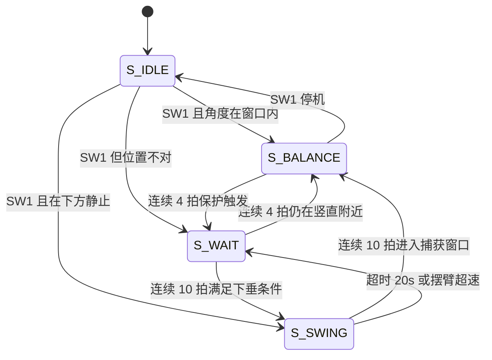

# LQR 旋转倒立摆控制器（FPGA）

用 **LQR 四状态状态反馈** 代替 PID 双环，控制 J280 + IP570 旋转倒立摆。
纯 Verilog-2001，50 MHz 单时钟域，无软核。

| 项目 | 值 |
|---|---|
| 器件 | GW2A-LV55PG484C8/I7（GW2A-55C） |
| 时钟 | 50 MHz |
| 反馈周期 | **5 ms**（微分项固定用 **20 ms** 窗口） |
| 遥测 | 9600 8N1，12 字节 / 20 ms |
| PWM 载波 | 5400（≈9.26 kHz），`PWM_MAX = 5300` |
| 资源 | 2239 Logic (5%)、771 Register (2%)、3.5 DSP (18%) |
| 时序 | ✅ **0 违例**，最差 setup slack **+0.379 ns** |

---

## 1. 控制律

```
u = -( K_th·θe + K_thd·θ̇e + K_al·α + K_ald·α̇ )
```

| 状态量 | 定义 | 单位 |
|---|---|---|
| `θe` | 摆臂位置误差 `enc_rel − θ_ref` | 编码器计数（**1040 计数/圈**） |
| `θ̇e` | 20 ms 差分 `enc − enc_h4` | 计数 / 20 ms |
| `α` | 摆杆倾角误差 `angle − angle_mid`（经 `ANGLE_INV`） | ADC 计数（**11.92 计数/°**） |
| `α̇` | 20 ms 差分 `ang_db − ang_h4` | 计数 / 20 ms |

### 增益（Q8 定点，实际值 = 参数 / 256）

| 参数 | Q8 值 | 实际值 | 说明 |
|---|---|---|---|
| `K_TH` | 1138 | **4.4459** | PWM / count |
| `K_THD` | 61130 | **238.79** | PWM / (count/20ms) |
| `K_AL` | 4520 | **17.656** | PWM / count |
| `K_ALD` | 19973 | **78.02** | PWM / (count/20ms) |

四项**同号为正**（极性已由 `ANGLE_INV = 1`、`SWING_INV = 1` 统一）。

### 增益是怎么来的

参考 WHEELTEC 旋转版源码（MATLAB `dlqr`，Ts = 20 ms，Q = diag(6000,0,2000,0)，R = 1）：

```
k = [-1.6349, -1.7563, +26.8000, +2.3682]     (rad, rad/s, 12 V)
```

参考板 `Moto = 7200 × (u/12)` → 600 PWM/V；本工程载波 5400 → **450 PWM/V**。换算：

```
K = |k| × (rad per count) × (PWM per volt)
```

| 增益 | 计算 | 结果 |
|---|---|---|
| `K_TH` | 1.6349 × (2π/1040) × 450 | 4.446 |
| `K_THD` | 1.7563 × (2π/1040 × 50) × 450 | 238.8 |
| `K_AL` | 26.8 × (π/180/11.92) × 450 | 17.66 |
| `K_ALD` | 2.3682 × (π/180/11.92 × 50) × 450 | 78.02 |

核对脚本：`python tools/lqr_check.py`（会打印换算误差，当前四项误差 < 0.5%）。

> ⚠ 若换机构（摆杆长度 / 质量 / 传动比不同），必须重新用 MATLAB 算 K，
> 或按下面的调参表微调。

---

## 2. 为什么微分项用 20 ms 窗口

速度量的量化台阶直接变成力矩跳变：

| 状态 | × 增益 | 台阶（占 ±5300） | 影响 |
|---|---|---|---|
| `θe` | × 4.45 | 4.4 PWM (0.08%) | 可忽略 |
| `α` | × 17.7 | 17.7 PWM (0.33%) | 可接受 |
| `θ̇e` | × 238.8 | **238.8 PWM (4.4%)** | **抖动首恶** |
| `α̇` | × 78.0 | 78.0 PWM (1.4%) | 明显 |

所以速度项取 4 级历史（`enc_h1..h4` / `ang_h1..h4`），每个 5 ms 拍都能拿到
「正好 20 ms 前」的采样，量化台阶被压低 4 倍。

**实测结论：给速度项再加任何低通（哪怕 5 ms）都会立刻失稳。**
这个闭环对速度通道相位极其敏感 —— 滤波这条路走不通，要么缩短窗口，要么改用状态观测器。

---

## 3. 平衡死区与位置积分（LQI）

### 平衡死区 `BAL_DEADBAND = 5` counts

`|α| ≤ 5` 时角度误差归零，带外则减去阈值（**连续型**，边界无跳变）。
同时作用于 `α` 和 `α̇` —— 历史寄存器里存的就是死区后的值，
所以摆杆在死区内时 `α̇` 也 ≈ 0，把噪声侵入 D 项的路彻底封死。

### 位置积分（解决静摩擦粘滑）

**病根**：摆臂静摩擦约 90~180 PWM，而 `K_TH` 只有 4.45 PWM/count，
需要 **20~40 counts（7~14°）** 的偏差才能克服 → 表现为「位置环好像没作用、时不时滑很远」。
这是典型的 stick-slip，不是符号错误。

| 参数 | 值 | 含义 |
|---|---|---|
| `KI_Q8` | 43 | 0.168 PWM per (count · 5ms) |
| `I_MAX` | 4096 | 累积上限（≈688 PWM） |
| `I_WIN` | 120 | `|θe| > 120`（≈41°）立刻清零 |

标定：3° 偏差（≈9 counts）约 0.5 s 积到 150 PWM，刚好推开静摩擦；慢速（≈0.2 Hz）把残余偏差磨到 0。
只在 `S_BALANCE` 且偏差在窗口内时积分，起摆 / 摔倒时清零。

---

## 4. 分级限幅（SW2 档位）

单纯用 `PWM_MAX` 削顶会让近平衡区输出过大 → 抖动；放开又救不回来。
所以按「危险程度」分 5 级放开输出上限，判定取**两个判据里更危险的那个**：

```
等级 i：|α| ≥ A_i  或  |θe| ≥ T_i     （i = 0..3，第 4 级直接放开到 5300）
```

带回滞 `LV_HY = 4`：升级用 `A_i`，降级要退到 `A_i − 4`，防止阈值附近来回跳。

### 三张表（`lqr_ctrl.v` 的「限幅分级表」段）

| 档位 | 名称 | 特点 | 近平衡上限 L0 |
|---|---|---|---|
| `preset = 0` | 直通 | 完全不限幅（±5300），**不积分** —— 基线对照 | — |
| `preset = 1` | 表 A | 保守，近平衡权限大 | 2400 |
| `preset = 2` | 表 B | 中等，α 阈值挤在 122~128（极窄） | 1000 |
| `preset = 3` | 表 C | 激进，抖动抑制最强（**默认**） | **600** |

每级的阈值和上限都能单独改，见 `lqr_ctrl.v` 里 `A_A0..A_A3 / A_T0..A_T3 / A_L0..A_L3`。

---

## 5. 状态机



| 状态 | 编码 | LED 表现 |
|---|---|---|
| `S_IDLE` | 0 | 停止 |
| `S_SWING` | 1 | LED2 亮 |
| `S_BALANCE` | 2 | LED3 亮 |
| `S_WAIT` | 3 | 停止（等摆杆垂下来） |

**起摆**（能量泵）：`u = swing_cmd − SWING_DAMP·enc_d5`，
`swing_cmd` 由 `sign(α̇ · cos(α))` 的符号决定，幅值 `SWING_GAIN = 1000`。
连续 10 拍满足 `|α| < 450` 且 `|α̇| < 150` 才进 `S_BALANCE`。

---

## 6. 平衡点与自动标定

2026-10-27 实测：

| 位置 | ADC 读数 |
|---|---|
| 摆杆下垂 | **936** |
| 摆杆竖直 | **3082** |
| 差值 | **2146 = 180°** → 11.92 计数/° |

满量程 4092 / 11.92 = **343°**，与 WDD35D4 手册的 345° 只差 0.5% —— 两个独立测量互相印证。

`AUTO_CALIB = 1` 时，摆杆向下且静止会自动标定：

| 参数 | 值 | 含义 |
|---|---|---|
| `CALIB_SHIFT` | 6 | 窗口 64 拍 = **320 ms**（必须远大于摆动周期） |
| `CALIB_TOL` | 250 | 结果允许偏离 `ANGLE_DOWN` 的范围 |
| `CALIB_DRIFT_MAX` | 128 | 前后半段均值差 ≤ 4 counts 才认为静止 |
| `CALIB_STILL_MAX` | 24 | 单拍角度变化上限（≈4σ） |

标定后 `angle_mid = 下垂值 + MID_FROM_DOWN`，遥测帧里能看到当前 `angle_mid`。

---

## 7. 输入输出

### 按键 / 拨码

| 操作 | 功能 |
|---|---|
| **SW1** | 启动 / **任何状态下按 = 停机** |
| **SW2** | 停止时切换限幅档位 0→1→2→3（运行时按下无效） |
| **SW3** | 平衡中摆臂目标 **+30°**（87 counts，斜坡跟随） |
| **SW4** | 平衡中摆臂目标 **−30°** |
| **SW5** | 硬件复位 |
| **B3_SW1** | 按住把当前角度设为平衡点（手动覆盖自动标定） |
| **B3_SW2 拨 ON** | 编码器方向取反（低有效） |

停止时 **LED1~LED2 以二进制显示当前档位**（00/01/10/11），方便确认 SW2 有没有切过去。

### 串口协议（9600 8N1，每 20 ms 一帧，共 12 字节）

```
AA 55 | {state[3:0], angle[11:0]} | enc[15:0] | pwm[15:0] | {3'b0, db_flag, angle_mid[11:0]} | 0D 0A
  0 1        2        3              4    5       6    7              8                    9
```

| 字节 | 内容 |
|---|---|
| 0–1 | `AA 55` 帧头 |
| 2–3 | 高 4 位 = 状态机状态（0~3），低 12 位 = ADC 角度原值 |
| 4–5 | 16-bit 摆臂编码器 |
| 6–7 | 16-bit **有符号**控制输出 `pwm_cmd` |
| 8–9 | 高 4 位 = `{3'b0, db_flag}`，低 12 位 = 标定后的竖直点 `angle_mid` |
| 10–11 | `0D 0A` |

**无校验和、无下发通道** —— 本工程只上报，参数全部是编译期常量。

---

## 8. 调参速查

从稳到不稳，按这个顺序调：

| 现象 | 处理 |
|---|---|
| 整体抖动 / 啸叫 | 升档到 `preset = 3`（表 C，近平衡上限 600）；仍抖则降 `K_TH` 或 `K_AL` |
| 左右缓慢晃 | 增 `K_ALD`（或换更长的微分窗） |
| 站不住、往一边倒 | 增 `K_AL`；先确认 `ANGLE_INV` 正确 |
| 摆臂慢慢滑走、回不到原位 | 确认积分在跑（`preset ≠ 0`）；必要时增 `KI_Q8` |
| 捕获瞬间被拽一下 | 增 `MANUAL_WINDOW` 太大会误启动，改 `BAL_DEADBAND` |
| 起摆越摆越小 | `SWING_INV` 取反 |
| 起摆总超时 | 增 `SWING_GAIN`，或放宽 `CATCH_WINDOW` / `CATCH_VEL` |

> ⚠ **LQR 有效区约 ±45°**，`MANUAL_WINDOW = 350`（≈29°）就是按这个设的，别设太大。

---

## 9. 工程说明

### 综合 / 布线

```bash
cd LQR
gw_sh.exe build_check.tcl
```

### 遗留文件

`src/pendulum_ctrl.v`（PID 双环版，821 行）和 `src/traj_gen.v`（运动曲线发生器）
**不在 `.gprj` 的 `FileList` 里，不参与综合**，仅作参考保留：

- `lqr_ctrl.v` 的状态机、起摆能量泵、下垂自动标定、角度毛刺门、保护逻辑全部移植自 `pendulum_ctrl.v`
- `traj_gen.v` 只被 `pendulum_ctrl.v` 实例化（`pendulum_ctrl.v:218`），本工程未使用曲线功能

### 烧写

GW2A-55 无片内配置 Flash，Programmer 的 Operation **必须选 `External Flash Mode`**，
烧完**重新上电**才会从 Flash 加载。
