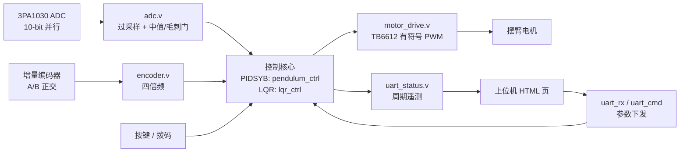

# FPGA 旋转倒立摆（Rotary Inverted Pendulum）

基于 **高云（Gowin）GW2A-55C** FPGA 的旋转倒立摆（Furuta 摆）控制器，用纯 Verilog-2001 实现
传感器采集、控制律、状态机、起摆与上位机通信，不依赖任何软核 CPU。

硬件平台：**J280 姿态控制系统开发套件**（GW2A-LV55PG484C8/I7）+ **WHEELTEC IP570** 旋转倒立摆机构。

---

## 工程一览

本仓库包含两套独立的控制方案，共用同一块板、同一套外设驱动，区别在控制核心：

| 目录 | 控制方案 | 状态 | 控制周期 | 资源占用 | 时序 |
|---|---|---|---|---|---|
| [`PIDSYB/`](PIDSYB/) | 角度 PD + 位置 PID + 能量泵/甩杆起摆 | 功能最全，含曲线运动、麦克风、摇杆 | 5 ms（位置环 25 ms） | 6114 LUT (12%)，13 DSP (65%) | ⚠ 239 个 setup 违例（TNS −1331 ns），功能可用 |
| [`LQR/`](LQR/) | LQR 四状态反馈 + LQI 位置积分 + 分级限幅 | 抖动抑制更好，功能精简 | 5 ms（微分窗 20 ms） | 2239 LUT (5%)，3.5 DSP (18%) | ✅ 0 违例，最差 slack **+0.379 ns** |

推荐先用 `LQR/` 验证机构与接线（时序干净、参数少），再用 `PIDSYB/` 做完整功能演示。



---

## 目录结构

```
FPGA-Rotary-Inverted-Pendulum/
├── README.md                   # 本文件：总体说明
├── build_check.tcl             # 命令行综合脚本（在子工程目录内运行）
├── bitstream/                  # 预编译比特流（可直接烧写）
│   ├── LQR_FPGA_Pendulum.bin      1.4 MB
│   └── PIDSYB_FPGA_Pendulum.bin   2.3 MB
│
├── LQR/                        # LQR 状态反馈方案
│   ├── build_check.tcl
│   ├── README.md               # 控制律、增益换算、调参、串口协议
│   ├── FPGA_Pendulum.gprj
│   ├── src/
│   │   ├── top.v               顶层：节拍、按键、模块互连
│   │   ├── lqr_ctrl.v          ★ LQR 控制核心（状态机 + 分级限幅 + LQI）
│   │   ├── adc.v               3PA1030 采集 + 过采样平均
│   │   ├── encoder.v           正交编码器四倍频
│   │   ├── key_filter.v        按键消抖
│   │   ├── motor_drive.v       TB6612 有符号 PWM
│   │   ├── uart_tx.v           8N1 发送
│   │   ├── uart_status.v       12 字节遥测帧（9600 8N1）
│   │   ├── FPGA_Pendulum.cst   管脚约束
│   │   └── FPGA_Pendulum.sdc   时序约束（50 MHz）
│   └── tools/
│       └── lqr_check.py        增益换算与输出量核对的 Python 脚本
│
└── PIDSYB/                     # PID + 能量泵方案（功能最全）
    ├── build_check.tcl
    ├── README.md               # 精简版说明（本仓库整理）
    ├── README_original.md      # 原始完整说明书（59 KB，含全部调试细节）
    ├── FPGA_Pendulum.gprj
    ├── src/
    │   ├── top.v               顶层：节拍、参数总线、软复位、麦克风
    │   ├── pendulum_ctrl.v     ★ 控制核心（1824 行，角度 PD + 位置 PID + 状态机）
    │   ├── alpha_beta.v        α-β 滤波器（位置/速度估计，D 项降噪）
    │   ├── motion_gen.v        固件内建运动曲线（正弦/三角/线性/四四拍）
    │   ├── mic_fft.v           MP34DT01 PDM 麦克风 + 单频 DFT 幅值检测
    │   ├── sin256.vh           正弦查找表（被 mic_fft 用 `include 引入）
    │   ├── adc.v               3PA1030 采集
    │   ├── encoder.v           正交编码器四倍频
    │   ├── key_filter.v        按键消抖
    │   ├── motor_drive.v       TB6612 有符号 PWM
    │   ├── uart_tx.v / uart_rx.v  8N1 收发
    │   ├── uart_cmd.v          命令帧解析（写参数）
    │   ├── uart_status.v       102 字节遥测帧（115200 8N1）
    │   ├── FPGA_Pendulum.cst   管脚约束
    │   └── FPGA_Pendulum.sdc   时序约束（50 MHz）
    └── tools/                  网页上位机（单文件 HTML，浏览器直接打开）
        ├── pos_console.html    主控制台：波形 + 全部参数面板 + 手轮模式
        ├── monitor_pidsyb.html 并集控制台：可切换 FPGA / STM32 两套协议
        └── serial_plot.html    早期 16 字节版本（已过期，仅存档）
```

---

## 硬件

### 器件与时钟

| 项目 | 值 |
|---|---|
| FPGA | GW2A-LV55PG484C8/I7（`GW2A-55C`） |
| 系统时钟 | **50 MHz**（M19） |
| 配置方式 | ⚠ **SRAM 型器件，必须烧到外部配置 Flash** 才能掉电保持 |

### 外设

| 外设 | 型号 | 接口 |
|---|---|---|
| 摆杆角度 | WDD35D4 电位器 + 3PA1030 ADC | 10-bit 并行 |
| 摆臂位置 | 增量编码器 | A/B 正交，**1040 计数/圈** |
| 摆臂电机 | 直流减速电机 + TB6612 | PWM + 双方向脚 |
| 手轮（可选） | 第二个编码器 + 电机（不驱动） | XH2 |
| 麦克风（仅 PIDSYB） | MP34DT01 | PDM，3.125 MHz 时钟 |
| 上位机 | PC | UART，CH340 |

### 管脚（两套工程一致）

| 信号 | 引脚 | 说明 |
|---|---|---|
| `clk_50m` | M19 | 50 MHz |
| `rst_n` | AB3 | SW5 / 复位按键 |
| `key_sw[0]` | T18 | SW1 启动 / 停止 |
| `key_sw[1]` | R18 | SW2 档位 / 模式 |
| `key_sw[2]` | U20 | SW3 目标 + |
| `key_sw[3]` | T20 | SW4 目标 − |
| `cal_sw` | W20 | B3_SW1 平衡点校准（低有效） |
| `dir_sw` | V20 | B3_SW2 编码器方向取反（低有效） |
| `uart_tx` / `uart_rx` | K20 / L20 | 串口 |
| `adc_clk` / `adc_oe_n` / `adc_stby_n` | G18 / H20 / T6 | 3PA1030 |
| `adc_data_in[9:0]` | E19,G17,G19,H19,H18,D19,J19,J20,M21,L21 | 10-bit 并行 |
| `enc1_a` / `enc1_b` | Y20 / AA20 | 编码器 1（XH1） |
| `enc2_a` / `enc2_b` | W18 / W17 | 编码器 2（XH2，手轮） |
| `pwma` / `ain1` / `ain2` | Y18 / Y17 / Y19 | TB6612 A 通道（XH2） |
| `pwmb` / `bin1` / `bin2` | V14 / V15 / AA17 | TB6612 B 通道（XH1，摆臂） |
| `led[3:0]` | U18 / U19 / U17 / T17 | LED1~LED4 |
| `mic_clk` / `mic_data` | V16 / U16 | ⚠ 仅 PIDSYB，**必须按实际板子核对** |

> 两个工程都默认 `MOTOR_SEL = 1`（B 通道 = XH1 = 摆臂）、`USE_ENC2 = 0`（enc1 = 摆臂）。
> 摆臂电机必须与其编码器插在**同一个 XH 接口**上。

---

## 编译

### 方式一：Gowin EDA 图形界面

1. `File → Open Project`，选择 `LQR/FPGA_Pendulum.gprj` 或 `PIDSYB/FPGA_Pendulum.gprj`
2. 确认器件为 `GW2A-LV55PG484C8/I7`
3. `Synthesize` → `Place & Route`
4. `Tools → Programmer` 下载

### 方式二：命令行

```bash
cd LQR
"C:\Program Files\Gowin\Gowin_V1.9.12.03\IDE\bin\gw_sh.exe" build_check.tcl
```

### 烧写（重要）

GW2A-55 是 **SRAM 型 FPGA**，片内无配置 Flash：

| Operation | 掉电后 | 用途 |
|---|---|---|
| `SRAM Program` | ❌ 丢失 | 仅调试 |
| **`External Flash Mode`** | ✅ 保留 | **正常使用选这个** |

烧写后需**重新上电**（按复位键不会从 Flash 重载）。

---

## 快速上手

1. **不接电机电源**，先下载逻辑，打开串口（`LQR`: 9600，`PIDSYB`: 115200）确认有帧输出
2. 让摆杆自然下垂，等待自动标定（`LQR` 约 320 ms，`PIDSYB` 上电后按校准流程）
3. 手动把摆杆扶到竖直附近，按 **SW1** 启动，确认能站住
4. 方向不对时：角度反向 → `ANGLE_INV`，编码器反向 → `ENC_INV` / B3_SW2，电机反向 → `motor_drive` 的 `PWM_INV`
5. 站住后再调位置环 / 起摆

详细调试步骤见各子工程的 README。

---

## 两点必须知道的事

**1. `LQR/` 里的 `pendulum_ctrl.v` 和 `traj_gen.v` 是遗留代码。**
它们**不在** `.gprj` 的 `FileList` 里，综合时完全不参与，仅作 PID 版本的参考保留
（`lqr_ctrl.v` 的起摆、标定、保护逻辑正是从它移植的）。

**2. 角度标度是这套机构最容易踩的坑。**
`PIDSYB` 实测：摆杆从竖直转到下垂，180° 只跨越 **534 个 ADC 计数**（旧版误用 3003）。
这类标度变化会同时反向影响「增益型」和「阈值型」参数，换传感器/传动比后必须整套重算 ——
`PIDSYB/src/top.v` 用 `SPAN_CNT_180` 常量统一处理，只改一个数字即可。
`LQR` 的标度是 11.92 计数/度（2146 计数 / 180°），两套工程**不通用**。

---

## 参考

控制算法移植自 **WHEELTEC IP570 旋转倒立摆 STM32 源码**（`Balance()` / `Position()` / `Auto_run()`），
并针对 FPGA 的定点和并行特性重写。

LQR 增益来自同机构的 MATLAB `dlqr` 结果（Ts = 20 ms，Q = diag(6000,0,2000,0)，R = 1），
换算过程见 [`LQR/tools/lqr_check.py`](LQR/tools/lqr_check.py)。

---

## 许可

本仓库暂未声明开源许可。如需他人复用，建议补充 `LICENSE`（如 MIT / Apache-2.0）。
